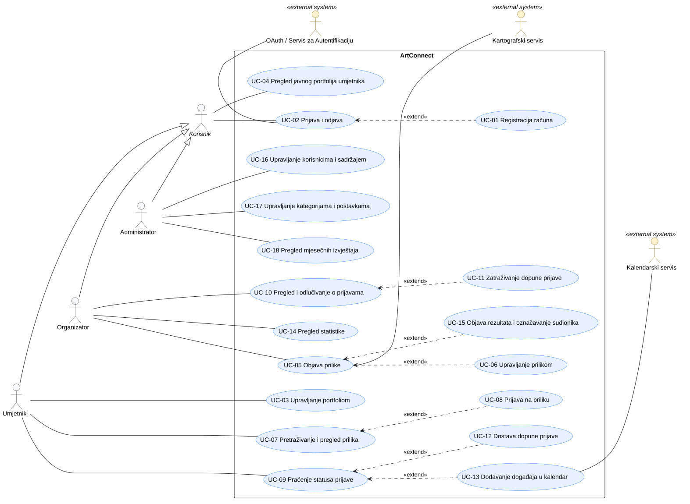

# 3. Obrasci uporabe

## 3.1 Dijagram obrazaca uporabe

**Slika 3.1. Dijagram obrazaca uporabe sustava ArtConnect**

**PlantUML izvor:** [izvor](./puml/3-1-artconnect-use-cases.puml)

**Opis dijagrama:** Dijagram prikazuje granicu sustava ArtConnect, tri primarna aktera (umjetnik, organizator i administrator) te tri sekundarna aktera (pružatelj identiteta OAuth 2.0, kartografski servis Google Maps API i kalendarski servis Google Calendar). Primarni akteri su specijalizacije apstraktnog aktera Korisnik, koji predstavlja mogućnosti zajedničke svim ulogama: prijavu i odjavu (UC-02) te pregled javnog portfolija umjetnika (UC-04). Uz to, primarni akteri imaju različite ovlasti: umjetnik upravlja portfoliom te pretražuje prilike i prijavljuje se na njih, organizator objavljuje prilike i odlučuje o prijavama, a administrator upravlja korisnicima, sadržajem, kategorijama i postavkama sustava. Prikaz lokacije na karti nije zaseban obrazac, nego dio objave prilike (UC-05).

Relacije `<<extend>>` koriste se za ponašanje koje se događa samo u nekim slučajevima:

- UC-01 (Registracija računa) proširuje UC-02 (Prijava i odjava) kad korisnik još nema račun.
- UC-06 (Upravljanje prilikom) proširuje UC-05 (Objava prilike) nakon objave prilike.
- UC-08 (Prijava na priliku) proširuje UC-07 (Pretraživanje i pregled prilika) kad se umjetnik odluči prijaviti na odabranu priliku.
- UC-11 (Zatraživanje dopune prijave) proširuje UC-10 (Pregled i odlučivanje o prijavama) kad organizator traži dopunu.
- UC-12 (Dostava dopune prijave) proširuje UC-09 (Praćenje statusa prilike) kad je status prijave „potrebna dopuna".
- UC-13 (Dodavanje događaja u kalendar) proširuje UC-09 (Praćenje statusa prilike) kad je umjetnik prihvaćen.
- UC-15 (Objava rezultata i označavanje sudionika) proširuje UC-05 (Objava prilike) nakon što je prilika završena.

## 3.2 Specifikacije obrazaca uporabe

Specifikacije opisuju ponašanje aplikacije kakvo jest u trenutačnoj implementaciji. Obrasci uporabe koji još nisu ostvareni označeni su kao **_Trenutačno oblikovanje_**: njihov opis izveden je iz zahtjeva i predstavlja planirano ponašanje, a ne ponašanje koje se već može demonstrirati.

### UC-01: Registracija računa

| Element specifikacije             | Opis |
| :-------------------------------- | :--- |
| **Primarni akter**                | Umjetnik ili organizator (novi korisnik) |
| **Sekundarni akter**              | OAuth 2.0 pružatelj identiteta (Google) |
| **Povezani zahtjevi**             | F-001, F-001.1, F-002 |
| **Preduvjeti**                    | Korisnik se prvi put prijavio putem Googlea (UC-02) i još nema dovršenu registraciju. |
| **Glavni uspješni tok**           | 1. Nakon prve prijave aplikacija prikazuje obrazac za dovršetak registracije. 2. Korisnik odabire ulogu umjetnika ili organizatora. 3. Umjetnik unosi ime, prezime, barem jedno područje umjetničkog djelovanja te, po želji, poveznice na web-stranicu ili društvene mreže; organizator unosi naziv i, po želji, vrstu organizacije. 4. Korisnik šalje obrazac; aplikacija provjerava podatke, sprema profil i dodjeljuje odabranu ulogu. 5. Aplikacija prikazuje početnu stranicu za odabranu ulogu. |
| **Alternativni tokovi / Iznimke** | **4a — Nedostaju obavezni podaci:** aplikacija prikazuje poruku uz polje koje nedostaje (ime, prezime, područje ili naziv organizatora); profil se ne sprema. **4b — Neispravna poveznica ili nepostojeće/neaktivno područje:** aplikacija odbija unos s porukom uz odgovarajuće polje. **4c — Zatražena uloga administratora:** aplikacija odbija registraciju; ulogu administratora nije moguće odabrati samostalno. **4d — Registracija je već dovršena:** aplikacija odbija ponovnu registraciju i postojeći profil ostaje nepromijenjen. |
| **Posljedice (ishod)**            | Korisnik ima dovršen račun s ulogom umjetnika ili organizatora. Račun organizatora sprema se kao neodobren dok ga ne odobri administrator (UC-16). |

### UC-02: Prijava i odjava

| Element specifikacije             | Opis |
| :-------------------------------- | :--- |
| **Primarni akter**                | Korisnik (umjetnik, organizator ili administrator) |
| **Sekundarni akter**              | OAuth 2.0 pružatelj identiteta (Google) |
| **Povezani zahtjevi**             | F-001 |
| **Preduvjeti**                    | Korisnik ima Google račun. |
| **Glavni uspješni tok**           | 1. Korisnik na početnoj stranici odabire prijavu putem Googlea. 2. Aplikacija ga preusmjerava pružatelju identiteta, gdje se korisnik prijavljuje. 3. Pružatelj identiteta vraća korisnika u aplikaciju, koja otvara sesiju. 4. Ako je registracija dovršena, aplikacija prikazuje početnu stranicu za ulogu korisnika. 5. Korisnik odabire odjavu; aplikacija završava sesiju i vraća ga na početnu stranicu. |
| **Alternativni tokovi / Iznimke** | **4a — Registracija nije dovršena:** aplikacija nastavlja s UC-01. **2a — Prijava kod pružatelja identiteta nije uspjela ili je otkazana:** korisnik ostaje neprijavljen i može ponovno pokušati prijavu. |
| **Posljedice (ishod)**            | Korisnik je prijavljen i ima pristup mogućnostima svoje uloge; nakon odjave zaštićeni podaci više nisu dostupni. |

### UC-03: Upravljanje portfoliom

> **_Trenutačno oblikovanje_ (korisničko sučelje):** ponašanje je ostvareno u pozadinskom sustavu i provjereno ispitnim slučajevima, ali stranice portfolija u web-klijentu još ne postoje.

| Element specifikacije             | Opis |
| :-------------------------------- | :--- |
| **Primarni akter**                | Umjetnik |
| **Povezani zahtjevi**             | F-002, F-003, F-004, F-005 |
| **Preduvjeti**                    | Umjetnik je prijavljen i ima dovršenu registraciju. |
| **Glavni uspješni tok**           | 1. Umjetnik otvara svoj portfolio; aplikacija prikazuje profil, područja djelovanja, djela i prethodne izložbe, uključujući privatna djela. 2. Umjetnik mijenja biografiju, opis rada, područja djelovanja ili poveznice; aplikacija sprema samo promijenjene podatke. 3. Umjetnik dodaje djelo s nazivom te, po želji, godinom nastanka, tehnikom, dimenzijama, opisom i oznakom javnosti; zatim djelu dodaje datoteke (poveznice na slike ili dokumente). 4. Umjetnik dodaje prethodnu izložbu ili projekt s nazivom, godinom i opisom. 5. Umjetnik po potrebi uređuje ili briše djelo, datoteku ili izložbu te određuje je li djelo javno. 6. Umjetnik određuje je li cijeli portfolio javno vidljiv. |
| **Alternativni tokovi / Iznimke** | **2a — Prazan popis područja, neaktivno područje ili prazno ime:** aplikacija odbija izmjenu i postojeći podaci ostaju nepromijenjeni. **3a — Djelo bez naziva ili s godinom u budućnosti:** aplikacija odbija spremanje s porukom uz odgovarajuće polje. **3b — Neispravna poveznica na datoteku:** aplikacija odbija datoteku s porukom. **4a — Godina izložbe u budućnosti:** aplikacija odbija spremanje. **5a — Pokušaj pristupa tuđem djelu, datoteci ili izložbi:** aplikacija se ponaša kao da zapis ne postoji i ne mijenja ga. |
| **Posljedice (ishod)**            | Portfolio je ažuriran. Djela označena kao privatna, kao i cijeli portfolio označen kao privatan, nisu vidljiva drugim korisnicima. |

### UC-04: Pregled javnog portfolija umjetnika

> **_Trenutačno oblikovanje_ (korisničko sučelje):** ponašanje je ostvareno u pozadinskom sustavu i provjereno ispitnim slučajevima, ali stranica javnog portfolija u web-klijentu još ne postoji.

| Element specifikacije             | Opis |
| :-------------------------------- | :--- |
| **Primarni akter**                | Korisnik (umjetnik, organizator ili administrator) |
| **Povezani zahtjevi**             | F-005, F-006, F-018 |
| **Preduvjeti**                    | Korisnik je prijavljen. |
| **Glavni uspješni tok**           | 1. Korisnik otvara profil umjetnika. 2. Aplikacija prikazuje ime, područja djelovanja, biografiju, javna djela s datotekama, prethodne izložbe i sudjelovanja na prilikama na kojima je umjetnik označen kao sudionik. |
| **Alternativni tokovi / Iznimke** | **2a — Portfolio je privatan, račun umjetnika je deaktiviran ili umjetnik ne postoji:** aplikacija prikazuje da portfolio nije pronađen. |
| **Posljedice (ishod)**            | Nema promjene podataka. Privatni podaci umjetnika (adresa e-pošte, uloga, privatna djela) nisu prikazani. |

### UC-05: Objava prilike

| Element specifikacije             | Opis |
| :-------------------------------- | :--- |
| **Primarni akter**                | Organizator |
| **Sekundarni akter**              | Kartografski servis (Google Maps API) |
| **Povezani zahtjevi**             | F-007, F-007.1, F-008 |
| **Preduvjeti**                    | Organizator je prijavljen i ima dovršenu registraciju. |
| **Glavni uspješni tok**           | 1. Organizator otvara obrazac za novu priliku. 2. Unosi vrstu (izložba, natječaj, radionica ili drugo), naziv, opis, područje umjetnosti, rok za prijavu te, po želji, adresu i lokaciju, vrijeme održavanja, dobni ili drugi kriterij i nagradu. 3. Aplikacija sprema priliku kao nacrt (status „priprema”). 4. Organizator objavljuje nacrt; aplikacija provjerava da prilika ima opis i rok te mijenja status u „otvoreno za prijave”. 5. Objavljena prilika postaje vidljiva umjetnicima; ako ima lokaciju, prikazuje se na karti. |
| **Alternativni tokovi / Iznimke** | **3a — Nedostaje naziv ili je rok u prošlosti:** aplikacija ne sprema priliku i prikazuje poruku uz polje. **4a — Organizator nije odobren:** aplikacija odbija objavu s obavijesti da račun još nije odobren; nacrt ostaje spremljen i može se objaviti nakon odobrenja. **4b — Nedostaje opis ili rok:** aplikacija odbija objavu s porukama uz polja koja nedostaju; prilika ostaje u pripremi. **5a — Kartografski servis nije dostupan:** prilika se prikazuje bez karte, a ostatak stranice radi normalno (NF-07). |
| **Posljedice (ishod)**            | Prilika je spremljena kao nacrt vidljiv samo organizatoru ili je objavljena i vidljiva umjetnicima. |

### UC-06: Upravljanje prilikom

| Element specifikacije             | Opis |
| :-------------------------------- | :--- |
| **Primarni akter**                | Organizator |
| **Povezani zahtjevi**             | F-009, F-010 |
| **Preduvjeti**                    | Organizator je prijavljen; prilika pripada njemu. |
| **Glavni uspješni tok**           | 1. Organizator otvara popis svojih prilika, uključujući nacrte, i odabire priliku. 2. Organizator uređuje priliku; nacrt se može mijenjati bez ograničenja, a objavljenoj prilici mogu se mijenjati samo lokacija, rok za prijavu i vrijeme održavanja. 3. Organizator mijenja status prilike prema dopuštenom redoslijedu: otvoreno za prijave → prijave zatvorene ili u procesu odabira; prijave zatvorene → ponovno otvoreno ili u procesu odabira; u procesu odabira → završeno. 4. Aplikacija sprema promjenu i prikazuje novo stanje prilike. |
| **Alternativni tokovi / Iznimke** | **1a — Tuđa prilika:** aplikacija se ponaša kao da prilika ne postoji. **2a — Izmjena zaključanog polja objavljene prilike:** aplikacija odbija izmjenu s porukom uz polje. **2b — Prilika je završena:** aplikacija ne dopušta nikakvu izmjenu. **2c — Brisanje prilike:** umjesto izmjene organizator briše priliku; nacrt se briše odmah, a za objavljenu priliku aplikacija traži obrazloženje, sprema ga i skriva priliku svim korisnicima. **2d — Brisanje objavljene prilike bez obrazloženja:** aplikacija odbija brisanje. **3a — Nedopušten prijelaz statusa:** aplikacija odbija promjenu i status ostaje isti. |
| **Posljedice (ishod)**            | Podaci ili status prilike promijenjeni su i promjena je odmah vidljiva umjetnicima; obrisana prilika više nije vidljiva, a obrazloženje brisanja ostaje spremljeno. |

### UC-07: Pretraživanje i pregled prilika

> **_Trenutačno oblikovanje_ (djelomično):** pregled objavljenih prilika i njihovih detalja je ostvaren; pretraživanje i filtriranje nisu.

| Element specifikacije             | Opis |
| :-------------------------------- | :--- |
| **Primarni akter**                | Umjetnik |
| **Povezani zahtjevi**             | F-011 |
| **Preduvjeti**                    | Umjetnik je prijavljen. |
| **Glavni uspješni tok**           | 1. Umjetnik otvara popis prilika; aplikacija prikazuje samo objavljene prilike. 2. Umjetnik zadaje kriterije: područje umjetnosti, lokaciju, rok za prijavu i druge kriterije; kriteriji se mogu kombinirati. 3. Aplikacija prikazuje samo prilike koje zadovoljavaju sve kriterije. 4. Umjetnik otvara detalje prilike. |
| **Alternativni tokovi / Iznimke** | **3a — Nijedna prilika ne zadovoljava kriterije:** aplikacija prikazuje prazan popis s obavijesti. **4a — Prilika je nacrt ili je obrisana:** aplikacija prikazuje da prilika nije pronađena. **4b — Umjetnik se želi prijaviti:** nastavlja se UC-08. |
| **Posljedice (ishod)**            | Nema promjene podataka; umjetnik je pronašao prilike koje ga zanimaju. |

### UC-08: Prijava na priliku

> **_Trenutačno oblikovanje_:** model podataka za prijave postoji, ali ponašanje još nije ostvareno.

| Element specifikacije             | Opis |
| :-------------------------------- | :--- |
| **Primarni akter**                | Umjetnik |
| **Povezani zahtjevi**             | F-012 |
| **Preduvjeti**                    | Umjetnik je prijavljen i ima otvorene detalje prilike sa statusom „otvoreno za prijave” (UC-07). |
| **Glavni uspješni tok**           | 1. Umjetnik odabire prijavu na priliku. 2. Odabire djela iz svog portfolija i prilaže dodatne materijale. 3. Umjetnik šalje prijavu; aplikacija je sprema sa statusom „predana”. |
| **Alternativni tokovi / Iznimke** | **1a — Prilika nije otvorena za prijave:** aplikacija ne dopušta prijavu. **3a — Neispravan prilog (vrsta ili veličina datoteke izvan NF-04):** aplikacija odbija prilog s porukom. |
| **Posljedice (ishod)**            | Prijava je evidentirana sa statusom „predana” i vidljiva organizatoru prilike. |

### UC-09: Praćenje statusa prijave

> **_Trenutačno oblikovanje_:** ponašanje još nije ostvareno.

| Element specifikacije             | Opis |
| :-------------------------------- | :--- |
| **Primarni akter**                | Umjetnik |
| **Povezani zahtjevi**             | F-013 |
| **Preduvjeti**                    | Umjetnik je prijavljen i ima barem jednu prijavu. |
| **Glavni uspješni tok**           | 1. Umjetnik otvara popis svojih prijava. 2. Aplikacija za svaku prijavu prikazuje priliku i trenutačni status (predana, u pregledu, potrebna dopuna, prihvaćena, odbijena) te razlog odbijanja ako postoji. |
| **Alternativni tokovi / Iznimke** | **2a — Status je „potrebna dopuna”:** umjetnik može nastaviti s UC-12. **2b — Status je „prihvaćena”:** umjetnik može nastaviti s UC-13. |
| **Posljedice (ishod)**            | Nema promjene podataka; umjetnik zna stanje svojih prijava. |

### UC-10: Pregled i odlučivanje o prijavama

> **_Trenutačno oblikovanje_:** ponašanje još nije ostvareno.

| Element specifikacije             | Opis |
| :-------------------------------- | :--- |
| **Primarni akter**                | Organizator |
| **Povezani zahtjevi**             | F-014 |
| **Preduvjeti**                    | Organizator je prijavljen; na njegovu priliku pristigla je barem jedna prijava. |
| **Glavni uspješni tok**           | 1. Organizator otvara prijave na svoju priliku. 2. Pregledava prijavu: portfolio umjetnika, odabrana djela i priložene materijale. 3. Organizator prihvaća ili odbija prijavu; pri odbijanju može unijeti razlog. 4. Aplikacija sprema odluku i mijenja status prijave. |
| **Alternativni tokovi / Iznimke** | **3a — Potrebni su dodatni materijali:** organizator nastavlja s UC-11. **1a — Prijava se odnosi na tuđu priliku:** aplikacija ne prikazuje prijavu. |
| **Posljedice (ishod)**            | Prijava ima status „prihvaćena” ili „odbijena”; razlog odbijanja vidljiv je umjetniku. |

### UC-11: Zatraživanje dopune prijave

> **_Trenutačno oblikovanje_:** ponašanje još nije ostvareno.

| Element specifikacije             | Opis |
| :-------------------------------- | :--- |
| **Primarni akter**                | Organizator |
| **Povezani zahtjevi**             | F-015 |
| **Preduvjeti**                    | Organizator pregledava prijavu u sklopu UC-10. |
| **Glavni uspješni tok**           | 1. Organizator odabire zatraživanje dopune i opisuje što nedostaje. 2. Aplikacija mijenja status prijave u „potrebna dopuna”. |
| **Posljedice (ishod)**            | Umjetnik u praćenju statusa vidi da se traži dopuna (UC-09). |

### UC-12: Dostava dopune prijave

> **_Trenutačno oblikovanje_:** model podataka za materijale prijave postoji, ali ponašanje još nije ostvareno.

| Element specifikacije             | Opis |
| :-------------------------------- | :--- |
| **Primarni akter**                | Umjetnik |
| **Povezani zahtjevi**             | F-015 |
| **Preduvjeti**                    | Prijava umjetnika ima status „potrebna dopuna” (UC-09). |
| **Glavni uspješni tok**           | 1. Umjetnik otvara prijavu i dodaje tražene materijale. 2. Umjetnik šalje dopunu; aplikacija sprema materijale i vraća prijavu u status „u pregledu”. |
| **Alternativni tokovi / Iznimke** | **2a — Neispravan prilog:** aplikacija odbija prilog s porukom; status prijave se ne mijenja. |
| **Posljedice (ishod)**            | Prijava je dopunjena i ponovno čeka odluku organizatora (UC-10). |

### UC-13: Dodavanje događaja u kalendar

> **_Trenutačno oblikovanje_:** model podataka za kalendarske zapise postoji, ali ponašanje još nije ostvareno.

| Element specifikacije             | Opis |
| :-------------------------------- | :--- |
| **Primarni akter**                | Umjetnik |
| **Sekundarni akter**              | Kalendarski servis (Google Calendar) |
| **Povezani zahtjevi**             | F-016 |
| **Preduvjeti**                    | Prijava umjetnika ima status „prihvaćena” (UC-09). |
| **Glavni uspješni tok**           | 1. Umjetnik odabire dodavanje događanja u kalendar. 2. Aplikacija u kalendar umjetnika dodaje događaj s nazivom prilike, datumom i mjestom održavanja. 3. Aplikacija potvrđuje da je događaj dodan. |
| **Alternativni tokovi / Iznimke** | **2a — Kalendarski servis nije dostupan ili pristup nije odobren:** aplikacija prikazuje poruku o neuspjehu; ostatak aplikacije radi normalno (NF-07). |
| **Posljedice (ishod)**            | Događaj je dodan u kalendar umjetnika i zabilježen u aplikaciji. |

### UC-14: Pregled statistike

> **_Trenutačno oblikovanje_:** stranica statistike postoji u web-klijentu, ali prikazuje samo obavijest da statistika još nije dostupna.

| Element specifikacije             | Opis |
| :-------------------------------- | :--- |
| **Primarni akter**                | Organizator |
| **Povezani zahtjevi**             | F-017 |
| **Preduvjeti**                    | Organizator je prijavljen. |
| **Glavni uspješni tok**           | 1. Organizator otvara stranicu statistike. 2. Aplikacija za njegove prilike prikazuje broj prijava po području umjetnosti, broj prihvaćenih umjetnika i broj prijava po pojedinoj prilici. |
| **Alternativni tokovi / Iznimke** | **2a — Organizator još nema prilika ni prijava:** aplikacija prikazuje nule ili praznu statistiku. |
| **Posljedice (ishod)**            | Nema promjene podataka; prikazani brojevi odgovaraju stvarnim podacima. |

### UC-15: Objava rezultata i označavanje sudionika

> **_Trenutačno oblikovanje_ (djelomično):** prikaz sudjelovanja na profilu umjetnika je ostvaren; objava rezultata i označavanje sudionika nisu.

| Element specifikacije             | Opis |
| :-------------------------------- | :--- |
| **Primarni akter**                | Organizator |
| **Povezani zahtjevi**             | F-018 |
| **Preduvjeti**                    | Prilika organizatora ima status „završeno”. |
| **Glavni uspješni tok**           | 1. Organizator otvara završenu priliku i odabire objavu rezultata. 2. Označava umjetnike koji su sudjelovali. 3. Aplikacija objavljuje rezultate i sprema oznake sudjelovanja. |
| **Posljedice (ishod)**            | Sudjelovanje se prikazuje na javnom profilu označenih umjetnika (UC-04); prilike koje su obrisane ne prikazuju se. |

### UC-16: Upravljanje korisnicima i sadržajem

> **_Trenutačno oblikovanje_ (djelomično):** administrator ove radnje trenutačno obavlja kroz Djangovo administracijsko sučelje (`/admin/`), a ne kroz web-klijent.

| Element specifikacije             | Opis |
| :-------------------------------- | :--- |
| **Primarni akter**                | Administrator |
| **Povezani zahtjevi**             | F-007.1, F-019 |
| **Preduvjeti**                    | Administrator je prijavljen putem OAuth 2.0 servisa i ima ulogu administratora. |
| **Glavni uspješni tok**           | 1. Administrator otvara popis korisnika, organizatora ili objavljenog sadržaja. 2. Pregledava zapis i odabire radnju: uređivanje, blokiranje ili uklanjanje korisnika ili sadržaja, odnosno odobravanje računa organizatora. 3. Aplikacija sprema promjenu. |
| **Alternativni tokovi / Iznimke** | **2a — Blokiranje (deaktivacija) umjetnika:** njegov portfolio prestaje biti vidljiv drugim korisnicima; nakon ponovne aktivacije opet je vidljiv. |
| **Posljedice (ishod)**            | Promjena je odmah vidljiva u sustavu; odobreni organizator može objavljivati prilike (UC-05). |

### UC-17: Upravljanje kategorijama i postavkama

> **_Trenutačno oblikovanje_ (djelomično):** administrator kategorije, kriterije pretraživanja i postavke trenutačno uređuje kroz Djangovo administracijsko sučelje (`/admin/`).

| Element specifikacije             | Opis |
| :-------------------------------- | :--- |
| **Primarni akter**                | Administrator |
| **Povezani zahtjevi**             | F-020 |
| **Preduvjeti**                    | Administrator je prijavljen i ima ulogu administratora. |
| **Glavni uspješni tok**           | 1. Administrator otvara kategorije umjetnosti, kriterije pretraživanja ili postavke sustava. 2. Dodaje, uređuje ili deaktivira stavku. 3. Aplikacija sprema promjenu. |
| **Alternativni tokovi / Iznimke** | **2a — Deaktivacija područja koje umjetnici već koriste:** područje se više ne nudi pri registraciji i ne prikazuje na profilima, ali veze s postojećim umjetnicima ostaju spremljene. |
| **Posljedice (ishod)**            | Kategorije, kriteriji i postavke ažurirani su i odmah se primjenjuju u aplikaciji. |

### UC-18: Pregled mjesečnih izvještaja

> **_Trenutačno oblikovanje_:** ponašanje još nije ostvareno.

| Element specifikacije             | Opis |
| :-------------------------------- | :--- |
| **Primarni akter**                | Administrator |
| **Povezani zahtjevi**             | F-020 |
| **Preduvjeti**                    | Administrator je prijavljen i ima ulogu administratora. |
| **Glavni uspješni tok**           | 1. Administrator otvara izvještaje i odabire mjesec. 2. Aplikacija prikazuje broj registriranih umjetnika, objavljenih prilika i predanih prijava u tom mjesecu. |
| **Posljedice (ishod)**            | Nema promjene podataka; prikazani brojevi odgovaraju stvarnim podacima. |

---

## 3.3 Provjera dosljednosti obrazaca uporabe

Provjera uspoređuje dijagram (3.1), specifikacije (3.2), zahtjeve i aktere (2.1, 2.3), ispitne slučajeve (5.2) i implementaciju. Cjelovito mapiranje zahtjev → obrazac uporabe → ispitivanje nalazi se samo u [matrici sljedivosti](2-Analiza-zahtjeva.md#26-sljedivost-zahtjeva).

| Provjera   | Pitanje                                                                                 | Nalaz |
| ---------- | --------------------------------------------------------------------------------------- | ----- |
| Zahtjev    | Je li svaki obrazac uporabe povezan s postojećim zahtjevom?                             | Da. Svaki od UC-01 – UC-18 navodi postojeće zahtjeve, a svaki zahtjev F-001 – F-020 pokriven je barem jednim obrascem. |
| Akter      | Odgovara li akter utvrđenoj ulozi i dopuštenoj interakciji?                             | Da. Akteri u 3.2 odgovaraju tablici aktera u 2.3 i ulogama u aplikaciji; ulogu administratora nije moguće odabrati registracijom (CT-09), nego se dodjeljuje naknadno. |
| Aplikacija | Može li se glavni rezultat demonstrirati ili je opis označen kao trenutačno oblikovanje? | Da. UC-01, UC-02, UC-05 i UC-06 mogu se demonstrirati; svi ostali obrasci u 3.2 označeni su kao _trenutačno oblikovanje_ uz kratko objašnjenje što nedostaje. |

**Ispravke provedene tijekom provjere:**

- U 2.3 ispravljeni su popisi zahtjeva uz aktere (uklonjeni nepostojeći F-021 i F-022 te zahtjevi pogrešno dodijeljeni ulogama).
- Popunjena je matrica sljedivosti u 2.6.
- U 5.2 dodani su ispitni slučajevi CT-61 – CT-106 za portfolio, koji su postojali u kodu, ali ne u dokumentaciji.
- Napisane su specifikacije UC-01 – UC-18 u 3.2.
- UC-09 preimenovan je iz „Praćenje statusa prilike” u „Praćenje statusa prijave”, jer se F-013 i proširenja UC-12 i UC-13 odnose na status prijave.

**Otvorena pitanja:**

- **Ponašanje bez ispitnog slučaja.** Odobravanje organizatora (F-007.1), prikaz karte (F-008) i upravljanje korisnicima (F-019) ostvareni su ili djelomično ostvareni, ali nemaju ispitni slučaj.

Provjeru treba ponoviti kad se ostvare obrasci označeni kao _trenutačno oblikovanje_.
